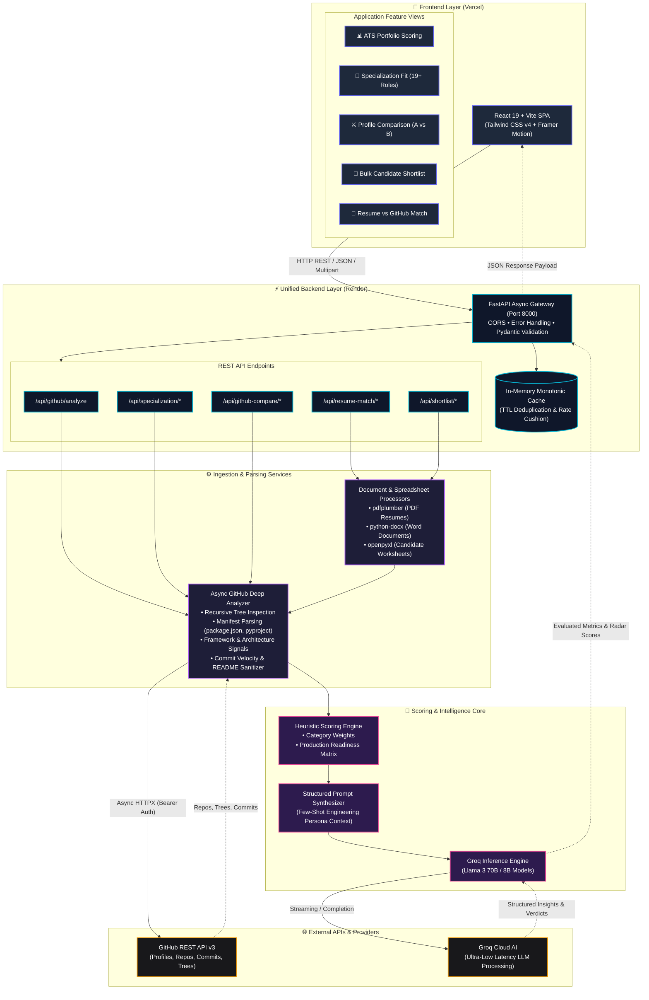
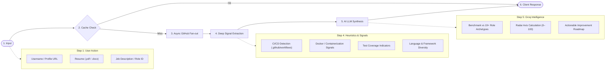

<div align="center">

# ⚡ Gitfolio

**Transform your GitHub into a job-ready, recruiter-approved portfolio in under 60 seconds.**

[](https://fastapi.tiangolo.com)
[](https://react.dev)
[](https://vite.dev)
[](https://tailwindcss.com)
[](https://www.python.org)
[](https://groq.com)
[](LICENSE)

[Features](#-key-features) • [Architecture](#-architecture) • [Getting Started](#-getting-started) • [API Reference](#-api-reference) • [Configuration](#-environment-variables)

</div>

---

## 📖 Overview

**Gitfolio** is an AI-powered GitHub profile intelligence platform built for both **software engineers** looking to optimize their portfolio and **technical recruiters** screening engineering talent.

By combining deep GitHub tree and repository analysis with fast LLM evaluation powered by Groq, Gitfolio eliminates guesswork from developer assessment. It audits codebases, inspects frameworks, measures production signals (CI/CD, Docker, tests, commits, and documentation), and benchmarks profiles against real-world job requirements.

---

## 🚀 Key Features

### 🎓 For Developers & Students
- **📊 ATS Portfolio Scoring & AI Feedback**: Audits commit velocity, documentation quality, tech stack breadth, and repo depth. Calculates a 0–100 ATS readiness score with actionable recruiter-grade improvement steps.
- **🎯 Specialization Fit Analysis**: Evaluates your GitHub footprint against **19+ target roles** (e.g., *SDE (FAANG)*, *Backend Engineer*, *Frontend Engineer*, *MLOps*, *DevOps*, etc.) or custom Job Descriptions. Visualizes skill radar charts, hiring readiness, missing signals, and a personalized learning roadmap.
- **📄 Resume vs. GitHub Verifier**: Upload your resume (`.pdf`, `.docx`, `.txt`) alongside your GitHub handle. The engine verifies claimed competencies against actual shipped code, detects exaggerated claims, and highlights uncredited skills found in your repos.

### 👔 For Recruiters & Hiring Managers
- **⚔️ GitHub Profile Compare**: Head-to-head comparison of two GitHub profiles. Evaluates code volume, consistency, architecture maturity, and repository quality with an automated AI winner verdict.
- **📑 Bulk Candidate Shortlisting**: Upload an Excel spreadsheet (`.xlsx`) containing candidate details and GitHub handles. The system automatically inspects all profiles in parallel with bounded concurrency, scores them against the Job Description, and generates a ranked candidate shortlist.

---

## 🏗️ Architecture & System Flow

Gitfolio is designed with a **cloud-native, two-tier decoupled architecture**. The frontend is deployed as an edge-optimized SPA on **Vercel**, while the backend runs as a high-performance, asynchronous service on **Render**.

### 1. High-Level System Architecture



---

### 2. End-to-End Analysis Pipeline



### Tech Stack Breakdown
- **Frontend**: React 19, Vite, Tailwind CSS v4, Framer Motion, Recharts, Axios, React Icons.
- **Backend**: FastAPI, Uvicorn, Pydantic v2, HTTPX (async client), Groq Python SDK.
- **File Parsing & Utilities**: `pdfplumber` (PDFs), `python-docx` (Word), `openpyxl` (Excel spreadsheets), in-memory TTL caching.

---

## 📂 Project Structure

```
Github-Project/
├── Frontend/                 # React 19 + Vite Single-Page Application
│   ├── src/
│   │   ├── components/       # Reusable UI components & layouts
│   │   ├── features/         # Feature hooks (compare, shortlist, specialization, resume)
│   │   ├── pages/            # Student & Recruiter views
│   │   ├── services/         # Axios API client (/api/* endpoints)
│   │   └── App.jsx           # Main routing & state
│   ├── vite.config.js        # Vite dev server configuration with /api proxy
│   └── package.json
│
├── Backend/                  # Unified FastAPI Application
│   ├── api/
│   │   └── routes/           # Public API routers (/api/github, /api/shortlist, etc.)
│   ├── services/             # Core business logic (GitHub deep analyzer, shortlist batcher)
│   ├── specialization/       # Role registries (19+ tech tracks) & fit analyzers
│   ├── resume_match/         # Resume extraction & cross-reference engine
│   ├── github_compare/       # Candidate comparison orchestration
│   ├── shortlist/            # Bulk candidate shortlisting engine
│   ├── utils/                # In-memory TTL cache, sanitizers, username & file parsers
│   ├── tests/                # Automated pytest suite (unit, route, e2e)
│   ├── main.py               # FastAPI entry point, CORS, routers & exception handlers
│   └── requirements.txt      # Python dependencies
│
├── package.json              # Root orchestration scripts (concurrent runner)
└── README.md
```

---

## 🛠️ Getting Started

### Prerequisites
- **Node.js**: v18.0.0 or higher
- **Python**: v3.10 or higher
- **uv** (recommended) or **pip**

### 1. Clone the Repository
```bash
git clone https://github.com/ArmanSunasara/Gitfolio.git
cd Gitfolio
```

### 2. Configure Environment Variables

#### Backend (`Backend/.env`)
Create a `.env` file in the `Backend/` directory:
```env
GROQ_API_KEY=your_groq_api_key_here
GITHUB_TOKEN=your_personal_access_token_here
CORS_ORIGINS=http://localhost:5173,http://127.0.0.1:5173,http://localhost:8000,http://127.0.0.1:8000
```
> **Tip**: A `GITHUB_TOKEN` is recommended to increase the GitHub API rate limit from 60 to 5,000 requests per hour. You can generate a free token at [GitHub Settings > Personal Access Tokens](https://github.com/settings/tokens).

#### Frontend (`Frontend/.env`)
Create a `.env` file in the `Frontend/` directory:
```env
VITE_API_URL=http://localhost:8000
```

### 3. Install Dependencies

#### Install Root & Frontend Dependencies:
```bash
npm install
npm run install:frontend
```

#### Install Backend Python Dependencies:
```bash
cd Backend
python3 -m venv .venv
source .venv/bin/activate
pip install -r requirements.txt
cd ..
```
*(Or with `uv`)*:
```bash
cd Backend && uv pip install -r requirements.txt --python .venv/bin/python && cd ..
```

---

## 🚦 Running the Application

### Option A: Run Both Concurrently (Recommended)
From the project root:
```bash
npm start
```
This runs:
- **Frontend**: [http://localhost:5173](http://localhost:5173)
- **Backend API**: [http://localhost:8000](http://localhost:8000)
- **Interactive Swagger Docs**: [http://localhost:8000/docs](http://localhost:8000/docs)

### Option B: Run Services Individually

**Start the Backend**:
```bash
npm run backend
# or: cd Backend && ./.venv/bin/uvicorn main:app --reload --port 8000
```

**Start the Frontend**:
```bash
npm run frontend
# or: cd Frontend && npm run dev
```

---

## 🧪 Testing

The backend includes a comprehensive automated test suite with **18 unit, route, and end-to-end integration tests**:

```bash
cd Backend
./.venv/bin/pytest tests/ -v
```

To run a production frontend build check:
```bash
cd Frontend
npm run build
```

---

## 📡 API Reference

| Endpoint | Method | Description |
| :--- | :--- | :--- |
| `/api/health` | `GET` | Service health status. |
| `/api/github/analyze` | `POST` | Deep portfolio analysis, commit velocity & ATS score for a GitHub handle. |
| `/api/github-compare/analyze` | `POST` | Side-by-side comparative analysis of two profiles. |
| `/api/resume-match/analyze` | `POST` | Multipart upload matching resume (`.pdf`, `.docx`, `.txt`) against GitHub activity. |
| `/api/specialization/roles` | `GET` | Returns all available specialized role profiles (19 tracks). |
| `/api/specialization/analyze` | `POST` | Evaluates GitHub profile against a specific role or custom Job Description. |
| `/api/shortlist/analyze` | `POST` | Multipart upload parsing candidate spreadsheet (`.xlsx`) and ranking against a JD. |

---

## 🛡️ License

This project is licensed under the **ISC License**.